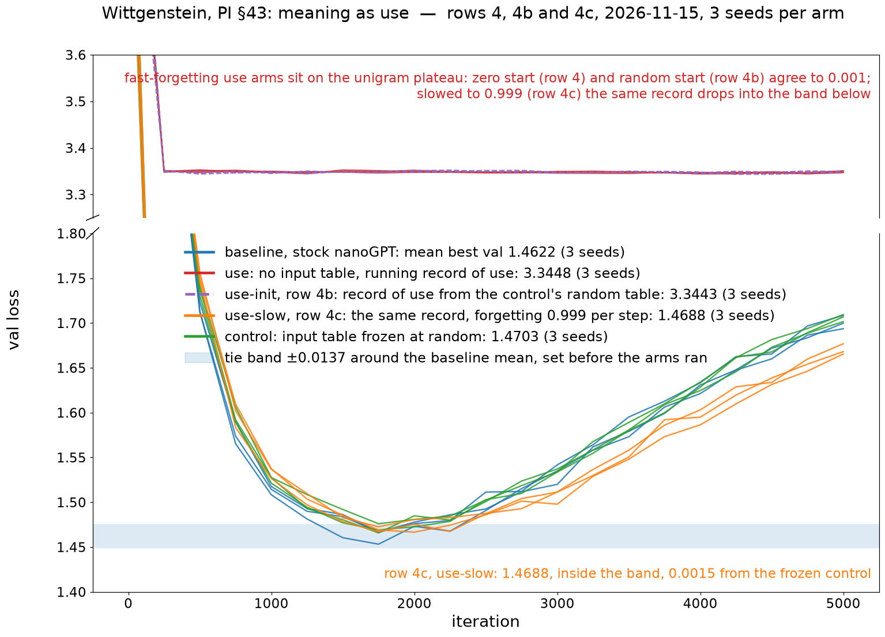

# Three claims about how a mind must be built, trained as small language models at matched compute

Take a thinker's claim about how a mind must be built. Derive from it one constraint on a small transformer. Train that model at a fixed budget and score it against the unmodified baseline at the same budget. The claim comes first, the network follows from it, and the number decides. This page holds the first three: Kant, Hume and Peirce, all run on 2026-11-15 on one RTX 3090.

Validation loss on nanoGPT's shakespeare_char task over 5000 iterations (the compute-matched baseline runs to 6667). Solid lines are the mean of seeds 1337 and 42, faint lines the seeds themselves, dots the minimum of each mean curve, and the number in the legend is the mean of the two seeds' own best values. The y-axis is clipped to 1.40–2.00, so the iteration-0 value near 4.2 is off the chart. Every run uses the stock config: 6 layers, 6 heads, 384 wide, dropout 0.2, batch 64, block 256, 5000 iterations, learning rate 1e-3 decayed to 1e-4.

## The baseline

Unmodified nanoGPT, with one patch so train.py takes a seed. 10,745,088 parameters. Best validation loss 1.4664 (seed 1337) and 1.4669 (seed 42), both at iteration 1750; mean 1.4667. After that the stock run overfits: final validation loss 1.7041 while training loss falls to 0.62. The judge for every variant is **best validation loss over 5000 iterations at the stock config, mean of two seeds**, with the final value reported beside it, never in its place. A difference over 0.01 on both seeds is a result; under 0.01 is a tie. These lines were fixed before any variant ran.

## Claim 1: Kant. The forms of judgement are given, not learned

Critique of Pure Reason, B 102–116: experience is possible only because a fixed set of forms is applied to intuition before any content, and those forms are not learned from experience and cannot be revised by it.

Translation: some of the relations a token may stand in to earlier tokens are given before training and are not parameters.

Constraint: in every layer, one of the six attention heads is a fixed relational head. Its attention pattern is a parameter-free function of relative position only (attend to the previous token), with no query and no key. The model learns only how to use that head's output; its value and output projections stay learnable. The freed query and key weights, 49,152 per layer, go to the MLP, 64 hidden units per layer, so the parameter count matches the baseline exactly at 10,745,088. Nothing else changes. What makes this Kant's constraint and not a generic prior: the relation is applied, not available. The model cannot learn the head away, because there is nothing in it to learn.

Prediction written before the run: p=0.30 the variant beats the baseline by more than 0.01; p=0.45 within 0.01; p=0.25 worse by more than 0.01.

Result: best validation loss 1.4896 and 1.4965, both at iteration 1250; mean 1.4930, which is 0.026 above the baseline on both seeds. Final 1.8340. The 0.25 arm came true. The variant also overfits sooner: its best moved from iteration 1750 to 1250.

Control, written before it ran: the same fixed head with the MLP at stock width (10,450,176 parameters, 2.7% under the baseline), to separate the head from the width. Prediction p=0.60 it lands within 0.01 of the widened variant. Result: 1.4923 and 1.4853, mean 1.4888, which is 0.004 from the widened variant and 0.022 above the baseline. The head, not the width, is the cause. Two caveats stand: the fixed head's path carries no dropout, and the comparison is at one scale and one task.

Verdict: Kant's form, given, did worse than the same form learned. A learned head attends to the previous token when that helps and elsewhere when it does not (previous-token heads arise on their own in every small transformer, Elhage et al. 2021); the fixed head spends a sixth of each layer's attention on a pattern the model would have learned anyway. The nearest earlier work is the fixed-attention-pattern literature for encoder-side machine translation (Raganato, Scherrer and Tiedemann 2020; You et al. 2020), with no claim behind it and no matched-parameter decoder test, which is the gap this run fills.

## Claim 2: Hume. No relation is given; every relation is learned from constant conjunction

Treatise I.iii.6 and Enquiry IV–VII: no necessary connexion is ever perceived; every relation between impressions is learned from their constant conjunction, and nothing is given before experience.

Translation: no positional information is given to the model. The learned position embedding is removed and only the token embedding enters the first layer, so whatever order the model knows, it learned from the constant conjunction the causal mask imposes. Nothing else changes. The removed embedding is 98,304 parameters, 0.9% of the total, inside the 1% line, so no matching. 10,646,784 parameters. Nearest earlier work: Haviv, Ram, Press, Izsak and Levy 2022, who found the no-position model close to the learned-position one at larger scale.

Prediction written before the run: p=0.55 within 0.01 of the baseline; p=0.35 worse by more than 0.01; p=0.10 better by more than 0.01.

Result: best validation loss 1.5329 and 1.5237 at iterations 2750 and 3000; mean 1.5283, which is 0.062 above the baseline on both seeds. The 0.35 arm came true; the near-parity of Haviv et al. does not hold at this scale and budget. Final 1.5795, with training loss still at 1.05–1.08.

Verdict: Hume's form-free model lost by more than Kant's on the number the page is judged on. It is also the only one of the four runs that did not fall apart: it peaked a thousand iterations later, barely overfit, and its final validation loss is 0.125 better than the baseline's. On the number the stock run ends on, the form-free model wins; on the best number, it loses.

## Claim 3: Peirce. Thought has an operation that fires on surprise, and surprise is measured against the thinker's own expectation

Collected Papers 5.189 (Harvard Lectures on Pragmatism, 1903): "The surprising fact, C, is observed; But if A were true, C would be a matter of course, Hence, there is reason to suspect that A is true." And 5.171: abduction "is the only logical operation which introduces any new idea."

What the stock model assumes: every position gets the same computation however expected or surprising its token was; nothing in the network measures its own surprise and nothing routes on it. Peirce denies that uniformity.

Constraint: head 0 of every layer loses its learned relevance score (query and key removed, as in Kant) and attends to each earlier position j ≤ t with weight proportional to 1/p(x_j), where p(x_j) is the probability the model itself assigned to token x_j given x_<j. That probability is read from a no-grad forward pass of the same current weights (dropout off, head 0 uniform over the prefix in that pass) before each training step; position 0 gets the uniform prior 1/65. The weights are softmax over surprisal in nats at temperature 1, no parameters. Value and output projections stay learned; heads 1 to 5 are stock; the MLP is widened to 1600 so the parameter count is 10,745,088, equal to the baseline. Why gradient descent does not find this on its own: a head at layer l scores from residual states at layer l, and the surprisal of x_j is a function of the final layer's output at the previous position, which is in no layer's residual stream at position j. The exact quantity needs the model's own completed pass, so the stock model cannot contain it.

Compute: the extra forward makes a step about 1.57× the stock step in wall time (predicted 1.25 to 1.45; the pass runs with autocast's weight cache off, which costs the rest). So the variant is judged twice: against the baseline at the same 5000 iterations, and against the baseline given more iterations, 6667 with the learning-rate decay stretched to match.

Prediction written before the run, against the 5000-iteration baseline: p=0.20 better by more than 0.01; p=0.35 within 0.01; p=0.45 worse by more than 0.01. Against Kant's widened variant: p=0.60 lower. Kill line: mean best 1.4766 or above on both seeds is a loss; under 1.4566 on both seeds and 0.01 under the compute-matched baseline is a win; between is a tie.

Result: best validation loss 1.4542 and 1.4659, both at iteration 2000; mean 1.4600, which is 0.0066 under the baseline at equal iterations and 0.0039 under the compute-matched baseline's 1.4639. Both are under the 0.01 line: a tie, twice. The 0.35 arm came true; the variant is lower than Kant's 1.4930. Final 1.6517 against the baseline's 1.7041, and the best iteration moved later, 2000 against 1750, so it overfits more slowly. The seed spread is 0.0117 for the variant and 0.0005 to 0.0050 for the baselines, the same size as the gaps; two seeds cannot separate these runs.

Two things the result does not show. First, the variant's first two runs did not learn at all (validation loss stuck near 2.57): under autocast, weight casts made inside the no-grad pass were cached and reused by the gradient pass, and almost no weight received a gradient. A shuffled-surprisal control and a control that ran the pass and discarded it both stalled the same way, which placed the fault in the pass and not the idea; wrapping the pass in `torch.autocast(cache_enabled=False)` fixed it, and only the fixed runs are scored (the broken logs are kept with the files). Second, the surprisal is computed with head 0 uniform, not with the head being trained, so it is the surprise of a slightly different function; that is the one arbitrary choice and it was not tested against the alternative. As with Kant, no dropout acts on head 0's path.

Verdict: Peirce's measured score tied the learned one. The first two claims gave the model a relation or took one away and lost; this one replaced a learned score with a quantity the model computes about itself and did not lose. That is a different outcome, not a win: by the line fixed before the run, a tie is a tie.

## The three

| variant | parameters | best val seed 1337 (iter) | best val seed 42 (iter) | mean best val | delta from baseline | final val mean |
|---|---|---|---|---|---|---|
| baseline (stock nanoGPT) | 10,745,088 | 1.4664 (1750) | 1.4669 (1750) | 1.4667 | +0.0000 | 1.7041 |
| Kant: fixed previous-token head, MLP widened to match | 10,745,088 | 1.4896 (1250) | 1.4965 (1250) | 1.4930 | +0.0264 | 1.8340 |
| Kant control: fixed head, stock MLP | 10,450,176 | 1.4923 (1500) | 1.4853 (1250) | 1.4888 | +0.0221 | 1.8210 |
| Hume: no position embedding | 10,646,784 | 1.5329 (2750) | 1.5237 (3000) | 1.5283 | +0.0616 | 1.5795 |
| Peirce: head 0 attends by the model's own surprisal, MLP widened to match | 10,745,088 | 1.4542 (2000) | 1.4659 (2000) | 1.4600 | -0.0066 | 1.6517 |
| baseline at 6667 iters (compute-matched to Peirce) | 10,745,088 | 1.4654 (1750) | 1.4624 (1750) | 1.4639 | -0.0028 | 1.8896 |

## Claim 4: Wittgenstein. The meaning of a word is its use in the language

Philosophical Investigations §43: "For a large class of cases — though not for all — in which we employ the word 'meaning' it can be defined thus: the meaning of a word is its use in the language."

What the stock model assumes: every token owns a free vector in an input table, learned by gradient and stored apart from any occurrence; meaning as a stored property of the word. §43 denies that there is such a stored thing to find.

Constraint: no free input table. A token's input vector is 0.02 times a buffer row holding an exponential moving average (decay 0.9) of the final-layer state at the position just before each occurrence of that token in earlier training steps: a record of the model's own use of the token under its current weights, written with no gradient. The output head keeps its own free table, so the parameter count is unchanged at 10,745,088 (the stock tree ties the two tables; here the tie is removed). Control arm: the input table present but frozen at its random normal(0, 0.02) init, so the cost of losing the learned table is measured apart from the cost of the record. Compute about 1.04× the stock step, so no compute-matched arm.

This row changed the judge, on a second model's reading of the ledger that held when checked: the 0.01 tie band of rows 1 to 3 had no relation to seed spread. From this row on there are three seeds per arm and a third baseline seed, and the band is the range of the three baseline seeds' best val (floor 0.002), computed and written into the ledger before any arm log was opened: 0.0137 (baseline 1.4664 / 1.4669 / 1.4532, mean 1.4622; seed 7 sits 0.013 under the other two, so the band is seven times what the first two seeds alone gave).

Prediction written before the run: variant vs baseline p=0.60 worse by more than the band with every seed above, p=0.30 within, p=0.10 better; control p=0.55 within the band; variant lower than control p=0.50. Kill line: mean at or above baseline + band with every seed above is a loss; at or below baseline − band with every seed below is a win; between is a tie. Attribution written before: both arms lose, the translation's; variant loses and control ties, the claim's as translated.

| arm | seed 1337 | seed 42 | seed 7 | mean best val | against the baseline | final val mean |
|---|---|---|---|---|---|---|
| baseline, stock nanoGPT | 1.4664 (1750) | 1.4669 (1750) | 1.4532 (1750) | 1.4622 | band ±0.0137 | 1.7006 |
| use: no input table, record of use | 3.3451 (4000) | 3.3443 (4000) | 3.3450 (4750) | 3.3448 | +1.8826, loss | 3.349 |
| control: input table frozen at random | 1.4760 (1750) | 1.4691 (1750) | 1.4658 (1750) | 1.4703 | +0.0081, tie | 1.7059 |
| use-init (row 4b): record of use starting from the control's random table | 3.3443 (4000) | 3.3452 (1000) | 3.3433 (4250) | 3.3443 | +1.8821, loss | 3.348 |
| use-slow (row 4c): record of use from the control's table, forgetting 0.999 per step | 1.4666 (2000) | 1.4726 (1750) | 1.4672 (1750) | 1.4688 | +0.0066, tie | 1.6701 |

Result: the use arm lost, by the written line and by a margin no band is near; the frozen control tied the baseline. So by the attribution written before the run the loss is the claim's as translated.

What the checkpoints show, measured after the run: the record was initialised at zero, so every token entered the network as the same vector; the layers' states then depended only on position; and the record written from those states became the same row for every token. In all three use checkpoints the 65 rows of the record have pairwise cosine mean 0.9999 (min 0.9976) and deviate from their mean row by 0.6% of its norm. The model never received token identity and sat at the position-only level, val 3.35, from iteration 1000 to 5000 (figure, top panel). A zero-initialised record is a fixed point of its own update. That is a fact about one choice in the translation and not about §43, and it was not predicted: the 0.60 call was made for a different reason (a record too noisy to serve as an embedding), so the row is a right call with a wrong mechanism, scored as a right call and marked.

Verdict: a record of use written from a state that carries no token identity carries none; use can constitute meaning only where something already tells the uses apart. Row 4b, written in the ledger before its run, keeps the wiring and breaks the symmetry: the record starts as the control's own random table and is then rewritten from use, so the two arms are the same network at step 0 and differ only in the update. Its prediction is 0.45 loss, 0.45 tie, 0.10 win. The control that frozen table tied the baseline, which already says this much: at this scale a learned input table is worth about 0.008 of val loss over a random one.

Row 4b, run the same evening: the record started at the control's random table, element for element (checked before training: max abs difference 0.000 for all three seeds), so every token entered the network as a different vector at step 0. The loss did not move: 3.3443 against 3.3448, and at the end the 65 rows of the record are again one vector (pairwise cosine mean 0.999 in all three seeds). The prediction written before the run, that the rows would stay apart (p=0.80), was wrong. The cause is not the symmetry but the timescale: the record forgets at 0.9 per step, so the random start is gone within fifty steps, and at those steps an untrained network's final states are near the same vector for every token; the record averages them into one row for all tokens, and the loop of row 4 closes from a different start. Row 4c, written in the ledger before its run, changes only that timescale: decay 0.999, so the record averages about a thousand steps of use and the start survives into the span where the network learns.

Row 4c, run an hour later: the same start, with the record's forgetting slowed from 0.9 to 0.999 per step, so it averages about a thousand steps of use. The loss came down to 1.4688, a tie with the baseline by the line written before the run, and 0.0015 from the frozen-random control. The record's 65 rows stayed distinct (pairwise cosine mean 0.23 to 0.26, against 0.999 in rows 4 and 4b), and the cause of the collapse is settled: the timescale of the write, not the start. What the tie means is narrower than it looks: the learned table, a frozen random table and a record of use all land within 0.01 of each other here, so at this size the input table is not where the loss lives, and no claim about it can be separated from its control by val loss.

---

No claim has beaten the stock model at matched compute. Kant's given form cost 0.02 and the loss is the head's. Hume's absent form cost 0.06 at its best and learned slowest, but it was the only variant that did not overfit by iteration 5000. Peirce's measured score tied the baseline on both comparisons, 0.007 under at equal iterations and 0.004 under at equal compute, with a seed spread the size of the gap; it is the only variant so far that did not lose, and it overfit more slowly than the stock run. Wittgenstein's record of use lost by 1.88, the largest loss on the page, and the loss is traced to the record's timescale, confirmed by row 4c: slowed to 0.999 the same record ties the baseline at +0.007, and its frozen-random control ties at +0.008, so the three tables cannot be separated here. The mean-best figure is the mean of the two seeds' own best values; where the seeds peak at different iterations (Kant control, Hume) the minimum of the plotted mean curve sits up to 0.005 above it.

## Files and reproduction

`baseline.json`, `kant_prevtoken.json`, `kant_control.json`, `hume_nopos.json`, `peirce_surprisal.json`, `baseline_6667.json`, `baseline_s7.json`, `wittgenstein_use.json`, `wittgenstein_frozen.json`, `wittgenstein_use_init.json`, `wittgenstein_use_slow.json` hold the config, parameter count, GPU, torch version, and the training and validation loss every 250 iterations for each seed. `plot.py` draws `val_loss.png` and `val_loss.svg` from them. `LEDGER.md` is the running record, one row per try: the sentence tried and its place in the text, the wiring, what was removed or added, the prediction written before the run, the result, and whose the loss is, the claim's or the translation's; a row is written before its run. Hardware: one RTX 3090, torch 2.6.0+cu124, about 310 seconds per 5000-iteration run; the Peirce variant takes 497 seconds and the 6667-iteration baseline 395. The model edits are each under twenty lines of nanoGPT's model.py: for Kant, head 0 of each layer has its query and key removed and its attention matrix replaced by the shifted identity, with `mlp_hidden` set to 1600 for the widened variant and left stock for the control; for Hume, `wpe` is not created and the first block receives `drop(tok_emb)`; for Peirce, the Kant tree's head 0 takes its attention matrix from a surprisal vector computed by a no-grad eval-mode forward of the current weights before each step (the diff is in `peirce_model.diff`); for Wittgenstein, the free input table is replaced by a buffer rewritten from the final-layer state after each training step, or kept and frozen for the control (`wittgenstein_model.diff`, `wittgenstein_train.diff`; `wittgenstein_band.md` is the band as written before the arms ran; `plot_wittgenstein.py` draws `wittgenstein_val_loss.png`).

Next run: a claim that changes what a score is computed from, the open half of the ledger's pattern, written in the ledger before it runs. A claim that beats the baseline at matched compute by more than the band with every seed below is the result this search is for; by 2027-01-14, if none has, the search ends and this page says so.
