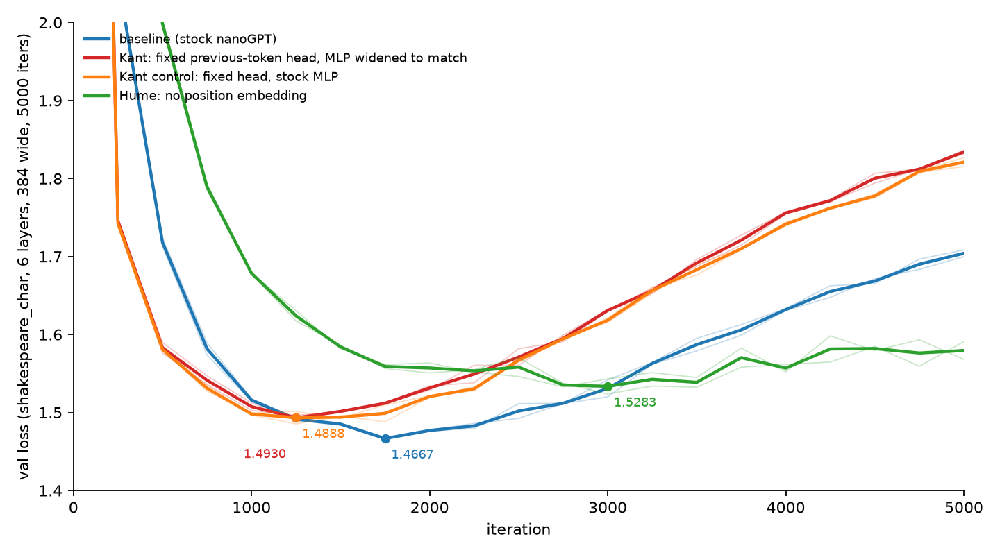

# Two claims about how a mind must be built, trained as small language models at matched compute

Take a thinker's claim about how a mind must be built. Derive from it one constraint on a small transformer. Train that model at a fixed budget and score it against the unmodified baseline at the same budget. The claim comes first, the network follows from it, and the number decides. This page holds the first pair: Kant and Hume, run on 2026-11-15 on one RTX 3090.

Validation loss on nanoGPT's shakespeare_char task over 5000 iterations. Solid lines are the mean of seeds 1337 and 42, faint lines the seeds themselves, dots the minimum of each mean curve. The y-axis is clipped to 1.40–2.00, so the iteration-0 value near 4.2 is off the chart. Every run uses the stock config: 6 layers, 6 heads, 384 wide, dropout 0.2, batch 64, block 256, 5000 iterations, learning rate 1e-3 decayed to 1e-4.

## The baseline

Unmodified nanoGPT, with one patch so train.py takes a seed. 10,745,088 parameters. Best validation loss 1.4664 (seed 1337) and 1.4669 (seed 42), both at iteration 1750; mean 1.4667. After that the stock run overfits: final validation loss 1.7041 while training loss falls to 0.62. The judge for every variant is **best validation loss over 5000 iterations at the stock config, mean of two seeds**, with the final value reported beside it, never in its place. A difference over 0.01 on both seeds is a result; under 0.01 is a tie. These lines were fixed before any variant ran.

## Claim 1: Kant. The forms of judgement are given, not learned

Critique of Pure Reason, B 102–116: experience is possible only because a fixed set of forms is applied to intuition before any content, and those forms are not learned from experience and cannot be revised by it.

Translation: some of the relations a token may stand in to earlier tokens are given before training and are not parameters.

Constraint: in every layer, one of the six attention heads is a fixed relational head. Its attention pattern is a parameter-free function of relative position only (attend to the previous token), with no query and no key. The model learns only how to use that head's output; its value and output projections stay learnable. The freed query and key weights, 49,152 per layer, go to the MLP, 64 hidden units per layer, so the parameter count matches the baseline exactly at 10,745,088. Nothing else changes. What makes this Kant's constraint and not a generic prior: the relation is applied, not available. The model cannot learn the head away, because there is nothing in it to learn.

Prediction written before the run: p=0.30 the variant beats the baseline by more than 0.01; p=0.45 within 0.01; p=0.25 worse by more than 0.01.

Result: best validation loss 1.4896 and 1.4965, both at iteration 1250; mean 1.4930, which is 0.026 above the baseline on both seeds. Final 1.8340. The 0.25 arm came true. The variant also overfits sooner: its best moved from iteration 1750 to 1250.

Control, written before it ran: the same fixed head with the MLP at stock width (10,450,176 parameters, 2.7% under the baseline), to separate the head from the width. Prediction p=0.60 it lands within 0.01 of the widened variant. Result: 1.4923 and 1.4853, mean 1.4888, which is 0.004 from the widened variant and 0.022 above the baseline. The head, not the width, is the cause. Two caveats stand: the fixed head's path carries no dropout, and the comparison is at one scale and one task.

Verdict: Kant's form, given, did worse than the same form learned. A learned head attends to the previous token when that helps and elsewhere when it does not (previous-token heads arise on their own in every small transformer, Elhage et al. 2021); the fixed head spends a sixth of each layer's attention on a pattern the model would have learned anyway. The nearest earlier work is the fixed-attention-pattern literature for encoder-side machine translation (Raganato, Scherrer and Tiedemann 2020; You et al. 2020), with no claim behind it and no matched-parameter decoder test, which is the gap this run fills.

## Claim 2: Hume. No relation is given; every relation is learned from constant conjunction

Treatise I.iii.6 and Enquiry IV–VII: no necessary connexion is ever perceived; every relation between impressions is learned from their constant conjunction, and nothing is given before experience.

Translation: no positional information is given to the model. The learned position embedding is removed and only the token embedding enters the first layer, so whatever order the model knows, it learned from the constant conjunction the causal mask imposes. Nothing else changes. The removed embedding is 98,304 parameters, 0.9% of the total, inside the 1% line, so no matching. 10,646,784 parameters. Nearest earlier work: Haviv, Ram, Press, Izsak and Levy 2022, who found the no-position model close to the learned-position one at larger scale.

Prediction written before the run: p=0.55 within 0.01 of the baseline; p=0.35 worse by more than 0.01; p=0.10 better by more than 0.01.

Result: best validation loss 1.5329 and 1.5237 at iterations 2750 and 3000; mean 1.5283, which is 0.062 above the baseline on both seeds. The 0.35 arm came true; the near-parity of Haviv et al. does not hold at this scale and budget. Final 1.5795, with training loss still at 1.05–1.08.

Verdict: Hume's form-free model lost by more than Kant's on the number the page is judged on. It is also the only one of the four runs that did not fall apart: it peaked a thousand iterations later, barely overfit, and its final validation loss is 0.125 better than the baseline's. On the number the stock run ends on, the form-free model wins; on the best number, it loses.

## The pair

| variant | parameters | best val seed 1337 (iter) | best val seed 42 (iter) | mean best val | delta from baseline | final val mean |
|---|---|---|---|---|---|---|
| baseline (stock nanoGPT) | 10,745,088 | 1.4664 (1750) | 1.4669 (1750) | 1.4667 | +0.0000 | 1.7041 |
| Kant: fixed previous-token head, MLP widened to match | 10,745,088 | 1.4896 (1250) | 1.4965 (1250) | 1.4930 | +0.0264 | 1.8340 |
| Kant control: fixed head, stock MLP | 10,450,176 | 1.4923 (1500) | 1.4853 (1250) | 1.4888 | +0.0221 | 1.8210 |
| Hume: no position embedding | 10,646,784 | 1.5329 (2750) | 1.5237 (3000) | 1.5283 | +0.0616 | 1.5795 |

Neither claim beat the stock model at matched compute. Kant's given form cost 0.02 and the loss is the head's. Hume's absent form cost 0.06 at its best and learned slowest, but it was the only one of the three variants that did not overfit by iteration 5000. The mean-best figure is the mean of the two seeds' own best values; where the seeds peak at different iterations (Kant control, Hume) the minimum of the plotted mean curve sits up to 0.005 above it.

## Files and reproduction

`baseline.json`, `kant_prevtoken.json`, `kant_control.json`, `hume_nopos.json` hold the config, parameter count, GPU, torch version, and the training and validation loss every 250 iterations for each seed. `plot.py` draws `val_loss.png` and `val_loss.svg` from them. Hardware: one RTX 3090, torch 2.6.0+cu124, about 310 seconds per run. The model edits are each under twenty lines of nanoGPT's model.py: for Kant, head 0 of each layer has its query and key removed and its attention matrix replaced by the shifted identity, with `mlp_hidden` set to 1600 for the widened variant and left stock for the control; for Hume, `wpe` is not created and the first block receives `drop(tok_emb)`.

Next claims, in order, not yet run: Peirce (abduction as a separate operation: one head per layer that attends only to the most surprising token under the model's own prediction) and Wittgenstein (meaning as use: the token embedding tied to a running average of its contexts, with no free embedding table). A claim that beats the baseline at matched compute by more than 0.01 on both seeds is the result this search is for; by 2027-01-14, if none has, the search ends and this page says so.
